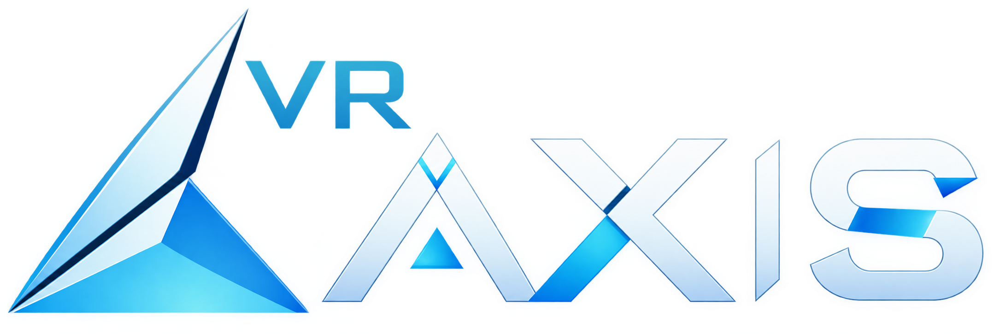

  

---

  <!-- Core Tech -->
  
  
  
  
  
  

  <!-- Dev & Collab -->
  
  

  <!-- Culture -->
  

---

## About Us

We are **AXIS VR**, a dynamic studio based in **Aguascalientes, México**.  
Our core focus is on developing **cutting-edge multimedia solutions**, including immersive:  
**Virtual Reality (VR)** | **Augmented Reality (AR)** | **Metaverse** | **Data-driven educational tools**

---

## Our Mission

To redefine learning and interaction by blending **VR/AR technologies** with **advanced data science**, creating customized educational experiences tailored for the future.

From **real-time anatomical visualization** to **immersive learning environments**, we're shaping how technology amplifies education and engagement.

---

## Visual Showcase

  
  
  
  

---

## Technologies & Specialties

- 🎮 **VR & AR Development** – Innovating immersive environments for training, education, and simulation.
- 🌐 **Metaverse & Web3 Integration** – Building interactive platforms for next-gen experiences.
- 📊 **Data Science in Education** – Leveraging AI & analytics to improve learning outcomes.

[🔗 LinkedIn Mexico][1] • [🌍 axislab.com.mx][3]

---

## Why Choose AXIS VR?

- 🎥 **Authentic Footage** — Lifelike anatomical & procedural simulations.
- 🧑‍🤝‍🧑 **Multidisciplinary Talent** — Bridging design, data, and emerging tech.
- ⚡ **Compact & Agile Team** — Efficient, innovative, and collaborative.

---

## Quick Stats

| Info          | Details                                                    |
| ------------- | ---------------------------------------------------------- |
| 📅 Founded    | 2023                                                       |
| 📍 Location   | Aguascalientes, México                                     |
| 👥 Employees  | 2–10                                                       |
| 🏭 Industries | Education, Training, XR Tech                               |
| 🎮 Core Tech  | Unity, C#, Blender, OpenXR, Meta Quest                     |
| 🌍 Projects   | VR/AR Apps, Educational Simulations, Metaverse Experiences |

---

## 👥 Meet the Team

   
  <strong>Luis Fernando Márquez</strong> Director and Founder

   
  <strong>Laura Sánchez</strong> Director and Founder

   
  <strong>Osmar Frausto</strong> Developer

   
  <strong>Alan Fernando</strong> Developer

   
  <strong>Daniel Hurtado</strong> Developer

---

## 🤝 Get Involved!

- 📱 Follow us on social media to witness our projects in motion.
- 🌍 Visit our website for demos & updates.
- 💬 Interested? Connect via LinkedIn or drop us a message!

[1]: https://mx.linkedin.com/company/axis-vr
[2]: https://axislab.com.mx
[3]: https://axislab.com.mx/education
